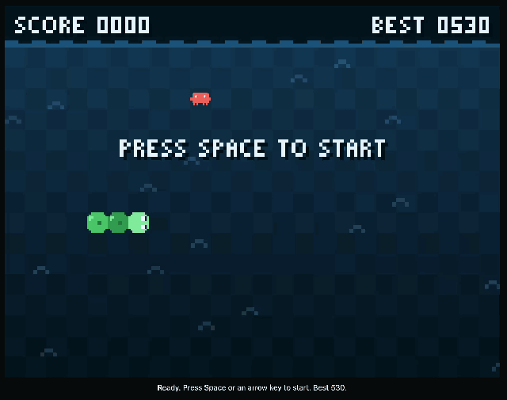

# Orca Snake 🐍🌊

A tiny Snake game that lives inside Orca, as a side panel plugin.

You steer a little green snake through the ocean and eat coding agents instead of apples.
Watch out for the bugs.



## How to play

Click the board once so it gets the keyboard, then:

| Key | What it does |
| --- | --- |
| Arrow keys or W A S D | Steer |
| Space | Start, resume, or play again |
| P or Esc | Pause |

## What's in the water

| Pickup | Points | What it does |
| --- | --- | --- |
| Pi | 10 | Grows you by 1 |
| Claude Code | 25 | Grows you by 2 and gives you a short speed boost |
| Codex | 50 | Grows you by 3 and gives you a shield that forgives one crash |
| Orca (very rare) | 100 | Bonus points, and it chases the bugs away |
| **Bug** | −20 | Cuts your snake in half. A shield squashes it instead. |

Hit a wall or your own tail and it's game over. Your best score is saved in the panel.

## Install

You need Orca 1.4.245 or newer.

```sh
git clone <this repo>
orca plugin dev load plugins/orca-snake
orca plugin open gentilfp.orca-snake --panel snake
```

Orca may print a fingerprint the first time. Re-run the `load` command with `--approve <fingerprint>`.
Or open the panel from the **Orca Snake** icon in the right sidebar.

No Orca? Open `plugins/orca-snake/dev.html` in any browser and play there.

## Hacking on it

The whole game is plain JavaScript in `src/game.js`, with no dependencies. The sprites are
character grids in that file, so you can redraw them by hand.

```sh
node plugins/orca-snake/scripts/build.mjs        # rebuild panel/index.html
node --test plugins/orca-snake/tests/*.test.mjs  # run the tests
```

The pixel art is hand drawn and is not the official logo of any product.

MIT licensed. See [LICENSE](LICENSE).
